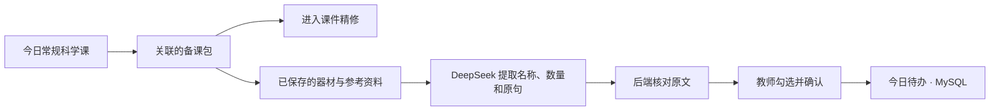

# 小学科学 AI 教师工作台 · 首页课前协同改造

2026 年 11 月 18 日。评估材料为 `ai建议3.md`。改造基线是已经支持教材照片识读、单页课件 AI 改写的本地工作台。网站入口为 `http://127.0.0.1:8000/#home`。

## 一堂课的使用路径

1. 教师登录后，在「今日 AI 课前协同」中选择课时。备课包卡片显示已关联的课题、课件修订号和页数，或提示关联备课包。
2. 在「实验器材待办」中点击「AI 提取器材清单」。后端读取当前教师名下该课的已保存参考资料，调用 DeepSeek Flash。课表、学生名单、其他备课包和教师待办无需随资料发送。
3. 教师逐项查看器材、数量和对应原句，勾选需要准备的项目，再确认加入今日待办。数量不明时留待核对。比如资料写「每组使用透明杯2个」，可以在确认时检查“每组”的含义。
4. 需要配图或识别器材时，可从「科学创作与识图」把提示词带入 AI 对话，再补充课题或照片并发送。随时按 `Ctrl+K` 搜索功能或起草一个问题，macOS 也支持 `⌘K`。



## 建议评估与本次取舍

| 建议 | 判断与交付情况 |
| --- | --- |
| 收拢为五个工作区 | 已实现。首页、备课、科学创作、教研与学情、多模态助手构成五个一级入口。已有课件、探究和教研页面沿用原地址；视频、虚拟实验等规划项有可见标记。原有作品与荣誉入口归入教研与学情。 |
| 首页改为三张联动卡 | 已实现。分别负责选课与打开备课包、按原文提取器材、带教学意图进入对话。多节课可切换；无课、未关联、资料为空和读取失败有各自提示。当天的课程列可显示关联课题及课件版本。 |
| 真实数据驱动 | 已实现。已同步的课表以账号数据为准，明确标出未同步的浏览器课表。统计仅含常规科学课，排除大课间、午管、午餐、延时和专项活动。数量来自资料；平行班合计、全班人数和组数需教师核对。 |
| AI 任务中心 | 已接入本标签页备课中心的课件生成、教材照片识读和单页改写。浮层显示阶段、运行用时或最近一次结果，可返回备课现场。切换应用内页面可保留备课组件；刷新、关闭浏览器或跨设备查询需要服务端任务记录。 |
| 快捷指令与自然语言 | 已交付功能搜索和提问草稿。自然语言可以带入对话，由教师确认后发送。复合指令自动修改课表、绑定课时和写待办留到后续，需先实现目标匹配、冲突检查、操作预览和撤销。 |
| 全站教研副驾驶 | 建议分步做。文稿润色应仅发送教师选中的段落，对比采纳后保留富文本结构；新课标对齐需有可核对的标准原文。周器材汇总需区分可复用器具、消耗品、每组用量与班级总量。出口题、实验记录单可继续沿用备课包的已核对材料。以上均为后续方案。 |

## 实现与数据边界

| 位置 | 作用 |
| --- | --- |
| `src/App.vue` | 工作区导航、当天课表与关联数据、顶栏搜索、备课任务浮层。 |
| `src/components/TodayWorkflow.vue` | 三张协同卡、课时选择、器材原文对照、勾选及确认导入。 |
| `src/components/ChatWorkspace.vue` | 从导航或搜索接收提问草稿，保留已有对话和输入中的草稿。 |
| `src/components/AiPrepWorkspace.vue` | 上报备课 AI 任务的进度与结果。 |
| `src/data/scheduleApi.js`、`src/data/useTodos.js` | 读取账号课表与器材建议，刷新今天和当前查看日期的待办。 |
| `backend/prep.py`、`backend/prep_ai.py` | `POST /api/v1/prep/lessons/{lesson_id}/equipment` 校验教师所有权并返回器材建议。只有可在资料中定位的器材才会展示；数量无法与器材对应时留空。 |
| 现有 `POST /api/v1/todos/import` | 教师确认后批量写入。按教师、日期、备课包、器材名和数量去重。同课题若需按班分别配料，当前仍由教师核算。 |

沿用数据库迁移 `0003`。器材提取结果在核对时临时显示，关闭即可放弃。待办一经确认即成为普通待办，可按原流程编辑、完成或删除。已删除的待办可以重新导入。

## 验收记录

- 前端生产构建成功。后端 43 项回归测试通过，含权限隔离、无资料、数量核对、预览无写入及重复导入。
- 无头 Chrome 在独立本机端口通过真实 FastAPI、临时 SQLite 及 DeepSeek 验证。从一节已关联的示例科学课开始，成功提取透明杯、纸巾，只勾选透明杯后待办从 0 项变为 1 项。
- 浏览器验证了五个一级入口、打开对应备课包、器材识别提问草稿和 `Ctrl+K` 自然语言草稿。测试使用合成教材资料；不同教师的复杂教材仍需在实际使用中核对识读效果。
- 使用可控制的模拟照片识读响应，验证了任务进行时切回首页、从任务浮层查看进度、完成后返回备课中心看到识读草稿。
- 本机 8000 端口已验证加载新版前端，MySQL 健康检查和器材接口注册检查通过。改造前备份已解压至独立目录，81 个源文件逐一校验成功，旧版备课与教材摘录的 8 项测试通过。

## 源码回退

改造前完整源码备份为 `.runtime/site-backups/before-ai-workflow-20261118-201025.zip`。包含当时工作树的 81 个源码、配置示例及文档文件，涵盖当时尚未提交的源代码。`_snapshot_manifest.json` 记录每个文件的 SHA-256。整包校验值为 `96ba182987eff271eefafb29f7740458308cf1340655c944024d03bf5bee3ce9`。

以下操作在独立目录启动旧版进行对照。备份属于源码快照，实际 `.env`、MySQL 教学数据、课件制品和本机依赖沿用现有项目。两版共用数据库时，在任一版本点击保存都会修改同一份数据。

```powershell
$root = 'G:\Basic-Software-and-Open-Source-Systems'
$zip = Join-Path $root '.runtime\site-backups\before-ai-workflow-20261118-201025.zip'
if ((Get-FileHash -LiteralPath $zip).Hash -ne '96ba182987eff271eefafb29f7740458308cf1340655c944024d03bf5bee3ce9') { throw '源码备份校验失败' }
$old = Join-Path $root ('.runtime\rollback-workflow-' + (Get-Date -Format 'yyyyMMdd-HHmmss'))
Expand-Archive -LiteralPath $zip -DestinationPath $old
Copy-Item -LiteralPath (Join-Path $root '.env') -Destination (Join-Path $old '.env')
Set-Location -LiteralPath $old
npm ci
if ($LASTEXITCODE -ne 0) { throw '前端依赖安装失败' }
npm run build
if ($LASTEXITCODE -ne 0) { throw '前端构建失败' }
$env:SKILL_ARTIFACT_DIR = Join-Path $root 'backend\artifacts'
$env:SKILL_MEDIA_DIR = Join-Path $root 'backend\media'
& (Join-Path $root '.venv\Scripts\python.exe') -m uvicorn backend.main:create_app --factory --host 127.0.0.1 --port 8001
```

如果已自定义课件或图片目录，请使用当前部署的实际路径。打开 `http://127.0.0.1:8001/#home` 检查旧版；确认恢复时，停止原端口的工作台进程，再从旧版目录用相同命令以 `8000` 启动。保留现用工作树，方便再次切回。
