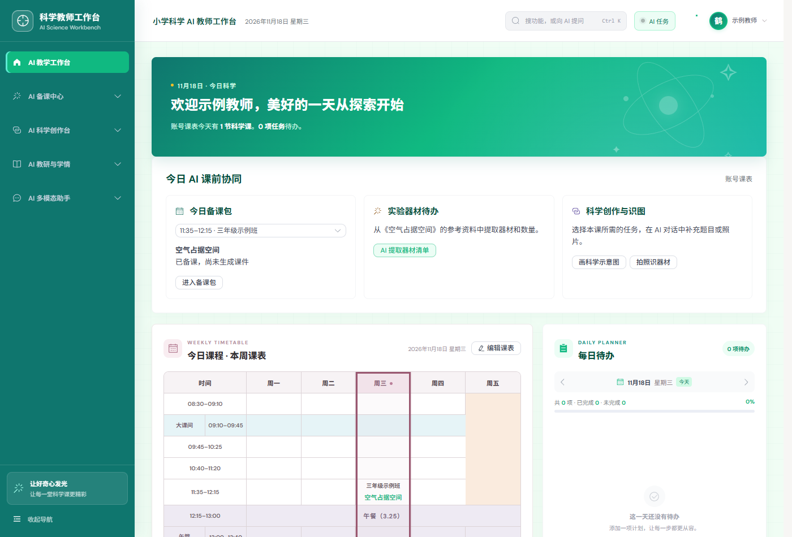

# 小学科学 AI 教师工作台

面向小学科学教师的浏览器工作台。项目希望把课表、待办和科学教学工具集中在一个界面中，逐步接入 AI 备课、实验设计与报告批改能力。

> **开发阶段：每日待办已接入 FastAPI 和 MySQL，AI 对话支持 DeepSeek 工具调用，并可使用内置课件工具 生成可编辑 PPTX。** `v0.1.0-frontend-baseline` 标签保存原始首页版本。

## 网站截图与操作流程

[查看图文操作指南：选择当天课程 → 准备备课包 → 核对器材并加入待办 → AI 对话](docs/teacher-guide.md)



## 当前功能

- 首页展示欢迎信息、快捷入口、本周课表和每日待办。
- 课表按周一至周五及时间段排列，标出当天所在列；支持大课间、午餐、午管、延时服务等分区。点击“编辑课表”可修改课程和空白格，在账号课表模式下确认保存至后端；在浏览模式下右键课程班级可确认添加或取消粉色标记。
- 欢迎信息中的科学课节数来自当天课表，不计入大课间、午餐、午管、延时服务、升旗仪式和教研；任务数来自当天未完成的待办。
- 登录教师账号后，待办支持按日期查看、新增、编辑、完成、删除、全部完成和清除已完成。记录由后端按账号存入 MySQL，可从原浏览器选择导入旧待办。
- 默认使用青绿科学主题，可在右上角头像菜单切换到原紫红配色。主题选择同样保存在浏览器本地。
- “教学筹备 → 科学课件生成”可填写课程主题、年级、课时、教学目标、重点与器材，按探究式课堂、实验演示、知识讲解三种固定模板预览课件大纲。
- 大纲支持逐页编辑、添加、删除、前后移动、下载 TXT，以及手动保存本地草稿。模板内容仅作交互示例，不调用 AI，也不生成 PPT 文件；草稿只保存在当前浏览器。
- “教学筹备 → 科学探究设计”提供提出问题、作出假设、制定计划、搜集证据、处理信息、得出结论六步编辑与实时预览。
- “教学案例”使用案例卡片，“教研论文”使用论文目录，“心得体会”使用反思日志，分别提供搜索、分类筛选和详情抽屉。阅读和编辑时可使用富文本正文，也可载入虚构示例作为写作起点。
- 科学探究设计及上述三个页面支持本地记录的新增、检索、编辑、删除和 Markdown 导出。未正式保存的输入也会暂存在当前浏览器。它们没有 AI 生成功能或后端同步。
- “AI 对话”登录后通过 FastAPI 请求 DeepSeek，支持科学快捷提问、会话搜索、Markdown／公式／表格展示、重新生成及插入课件。会话按教师账号保存在当前浏览器。对话实时显示文字和工具进度，可停止回复。Flash 支持发送图片进行分析，其他附件仅在本地预览。勾选「联网搜索」可查找有来源链接的公开资料。
- “AI 对话”已接入工具调用：模型可以先列出/读取本机 DSH 技能，再调用 `ppt-master` 把结构化大纲生成可编辑 PPTX；生成结果会以下载卡片出现在回复下方，文件按教师账号隔离存放在后端。
- 支持给课件配图：`search_images` 联网搜索真实图片（Bing 图片，按免费共享筛选，页面显示来源提示），`draw_image` 绘制带标签的科学示意图；有 `IMAGE_API_KEY` 时优先走 AI 绘图，没有时自动使用本地绘图器。
- 教学管理、科学创作和智能助手的其他未实现入口目前展示预览提示。

## AI 技能调用是怎么接上的

FastAPI 直接调用 DeepSeek 的流式接口，并在服务端运行课件生成、配图等工具。PPTX 由项目内置的渲染器导出，教师备注和可编辑文字、形状一起保存。桌面版 DeepSeek Harness 关闭后，网站仍可独立运行。

生成的 PPTX 默认保存在 `backend/artifacts/<教师ID>/`，配图保存在 `backend/media/<教师ID>/`。用户登录后可从聊天记录的下载卡片获取自己的文件。

AI 绘图是可选的，配置任意 OpenAI 兼容的图片生成接口即可：

```dotenv
IMAGE_API_KEY=
IMAGE_API_BASE=https://api.openai.com/v1
IMAGE_MODEL=gpt-image-1
```

没有配置时，`draw_image` 会生成本地带标签的科学示意图，不会调用外部图片模型。

## 技术栈

| 前端 | 后端 | 后续计划 |
| --- | --- | --- |
| Vue 3、JavaScript、Vite、Element Plus、Axios | Python、FastAPI、SQLAlchemy、Alembic、MySQL、JWT、DeepSeek API | Redis、Celery |

前端使用 JavaScript，不使用 TypeScript。AI API Key 将来应只存放在后端环境变量中，不能写入前端源码。

## 本地运行

Windows 本机已配置数据库和后端、且已构建前端时，在项目根目录执行 `.\start-workbench.ps1`，再打开 `http://127.0.0.1:8000/`。脚本会检查本机 API 和数据库连接，存在项目专用 `.runtime/mysql.ini` 时也会按需启动该 MySQL 实例。

需要 Node.js、npm、Python 3.10 或更新版本和 MySQL 8。数据库和教师账号的配置步骤见 [后端运行说明](backend/README.md)。先在项目根目录执行数据库迁移，再运行后端：

```powershell
.\.venv\Scripts\python.exe -m alembic upgrade head
.\.venv\Scripts\python.exe -m uvicorn backend.main:create_app --factory --host 127.0.0.1 --port 8000
```

另开终端启动网页：

```bash
npm ci
npm run dev
```

打开 `http://127.0.0.1:5173/`，在「教师登录」弹窗输入账号和密码。登录后可从右上角头像菜单退出。Vite 会将 `/api` 请求转给本机 FastAPI。旧待办需在原浏览器和原访问地址打开后手动导入。Vite 需要启动开发服务器来处理 Vue 文件和 npm 依赖，因此**不能通过双击 `index.html` 直接打开页面**。

检查生产构建：

```bash
npm run build
npm run preview
```

构建产物位于 `dist/`，该目录和 `node_modules/` 不提交到 Git；他人克隆仓库后运行 `npm ci` 即可重新安装依赖。

## 项目结构

```text
.
├─ backend/             # FastAPI、SQLAlchemy 模型、数据库迁移、技能注册与接口测试
│  ├─ skill_registry.py # 读取项目内置的技能说明
│  ├─ tools.py          # DeepSeek 工具定义与本地执行
│  └─ skill_runtime/    # ppt-master 适配器（SVG → 检查 → PPTX）
├─ src/
│  ├─ data/timetable.js   # 演示课表、课程与非课程事件标记
│  ├─ data/teachingPrep.js # 教学筹备页面字段和虚构示例
│  ├─ components/SlidesWorkspace.vue # 科学课件前端交互页面
│  ├─ components/TeachingPrepWorkspace.vue # 科学探究设计页面
│  ├─ components/LibraryWorkspace.vue # 案例、论文与反思文献库
│  ├─ App.vue             # 首页、导航和演示交互
│  ├─ style.css           # 原紫红主题及基础布局
│  ├─ timetable.css       # 课表布局与原配色
│  ├─ theme-science.css   # 青绿科学主题覆盖样式
│  ├─ slides-workspace.css # 科学课件页面样式
│  ├─ teaching-prep.css   # 科学探究设计页面样式
│  ├─ library-workspace.css # 文献库页面样式
│  ├─ prep-polish.css     # 教学筹备页面统一横幅与配色
│  └─ main.js             # Vue 应用入口
├─ index.html
├─ package.json
├─ package-lock.json
└─ vite.config.js
```

### 修改演示内容

- **教师姓名**：登录后显示创建账号时设置的姓名。
- **课表**：在首页点击“编辑课表”修改课程内容，保存后写入当前浏览器的 `localStorage`；右键课程班级可添加或取消标记。这些修改不会随 Git 提交或跨浏览器同步。要调整所有人首次打开时看到的样例课表，修改 `src/data/timetable.js`；已有本地课表的浏览器仍优先显示其已保存内容。
- **待办**：登录后从 MySQL 按账号和日期读取。同一账号可以在不同浏览器查看同一份待办；旧版浏览器待办可在登录后手动导入。
- **主题**：在头像菜单切换。紫红主题保留在 `style.css` / `timetable.css`，青绿主题位于 `theme-science.css`。
- **课件草稿**：在科学课件页面点击“保存草稿”，数据存入当前浏览器的 `localStorage`。点击“清空”会删除这份本地草稿；换浏览器或清理浏览器数据后无法恢复。
- **其他教学筹备记录**：每个页面分别使用 `localStorage` 保存正式记录和临时草稿。浏览器清理数据后无法恢复；Markdown 导出可用来手动备份当前内容。

## 后续迭代方向

1. 根据界面检查结果继续完善教学筹备模块；科学课件后续再接入真实 AI 生成与 PPT 文件导出。
2. 使用 Redis + Celery 处理耗时的 AI 生成任务。
3. 接入班级和实验报告管理。
4. 扩展科学绘图、虚拟实验、教学视频及实验数据分析功能。

以上为规划，并非当前版本已实现的功能。

## 版本与许可证

原始首页版本已标记为 `v0.1.0-frontend-baseline`，可从该标签查看。仓库包含 [GPL-3.0 许可证](LICENSE)。
