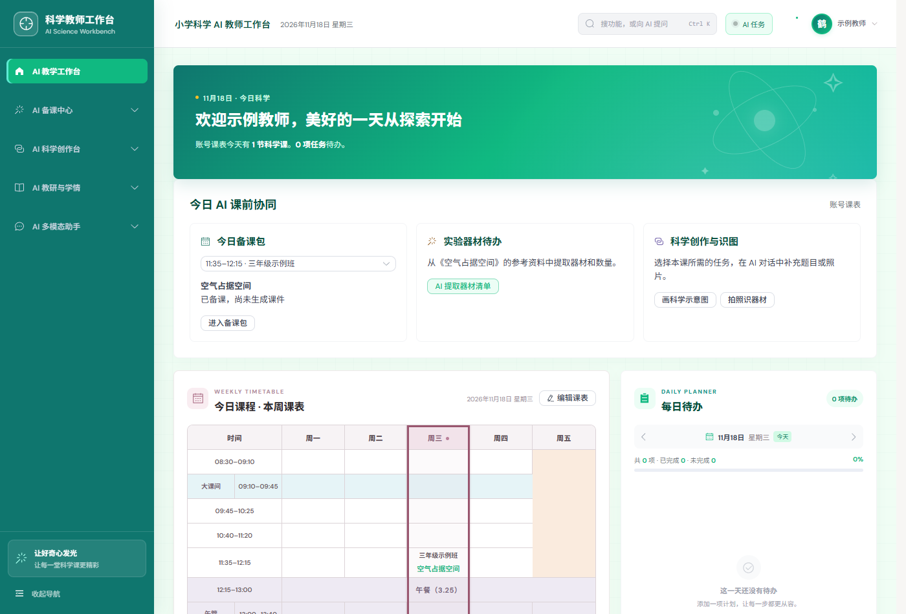
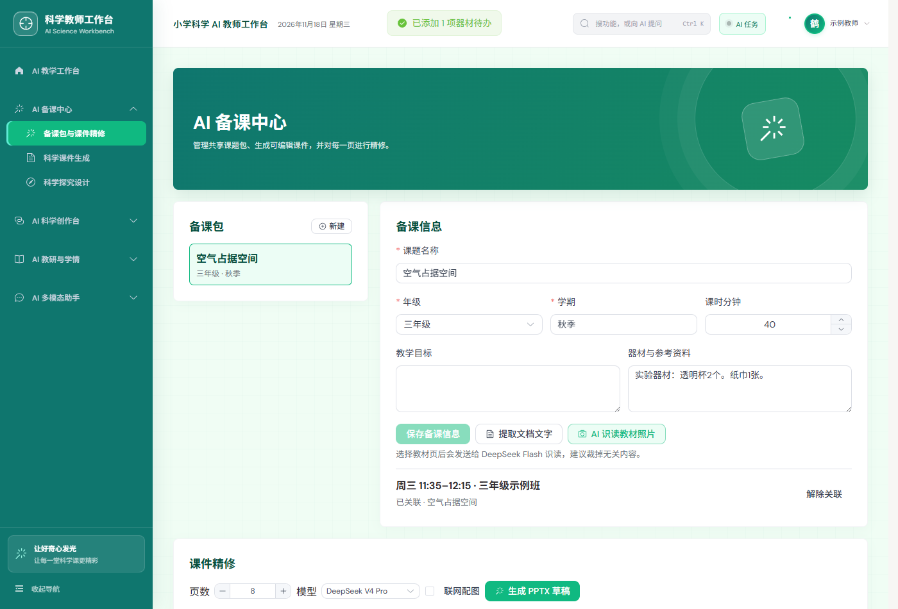
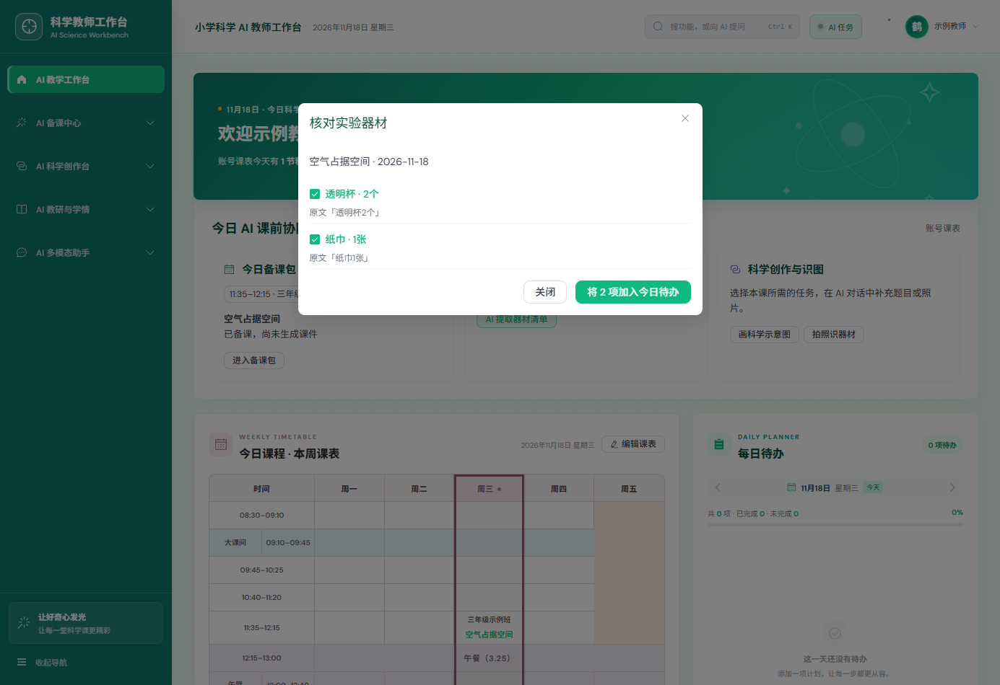
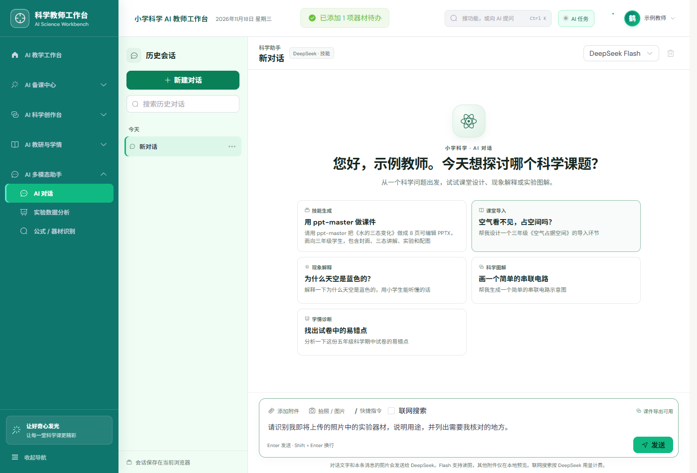

# 从当天课表到上课：教师操作指南

以下四张图来自实际浏览器，使用隔离的示例账号和三年级《空气占据空间》备课资料。器材提取和照片识读在截图演示中使用固定示例结果，便于复现；实际使用时须配置对应的服务。

## 1. 登录后，先选今天要上的课

在首页的 **今日 AI 课前协同 → 今日备课包** 下拉框选择节次。未绑定课题时点 **关联备课包**；已绑定时点 **进入备课包**。当天没有常规科学课，也可以点 **准备其他课程**。调整班级或节次时，到本周课表点 **编辑课表**，改完确认保存；浏览模式下右键班级可以添加或取消标记。

## 2. 准备课题与教材，核对后再生成课件

进入备课包，填写年级、课题、课时和参考资料。要让系统提取器材，建议写清每组或全班的用量，例如“每组透明杯 2 个、纸巾 1 张”。使用教材照片时，上传图片并核对识读草稿，尤其留意数字和单位。课件生成完成后，查看预览并核对科学表述，再下载 PPTX。离开页面后可从顶部备课任务入口返回处理现场。

## 3. 把实验器材加入当天待办

返回首页，选中该课，点 **AI 提取器材清单**。逐项对照清单下方的原文，取消不需要的项目，再点 **将所选项加入今日待办**（按钮会显示具体数量）。例如只勾选透明杯，首页便新增一条准备透明杯的待办；器材备齐后在每日待办中勾选完成。

## 4. 用 AI 对话追问或识别器材

从首页点 **拍照识器材**，AI 对话会预填问题。附上清晰的实物照片，补充年级和想解决的问题，确认后发送。也可以按 **Ctrl+K** 输入自己的问题，回车带入对话后再编辑。需要文件时说明用途、页数和格式；生成成功后，从回复中的文件卡片打开或下载。发送前的草稿不代表已经取得模型回复。
